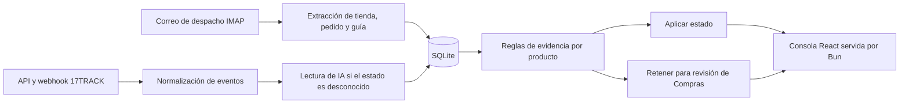

# Documentación técnica del MVP

GRAB IT · Seguimiento logístico multicanal · Entrega final · 18 de noviembre de 2026

[Centro de documentación](README.md) · [Manual de usuario](manual-usuario.md) · [Código fuente](https://github.com/EstebanForero/prototype-grabit) · [Video del MVP (5:03)](https://www.youtube.com/watch?v=Q6-VDQ_lRcY)

Base funcional verificada: [`071fb83`](https://github.com/EstebanForero/prototype-grabit/tree/071fb8357351e7d38d23e29d142617cfe1c2d6f0). La restauración [`d62585b`](https://github.com/EstebanForero/prototype-grabit/tree/d62585b3c1ed3523d89e8040e66ae2f918765038) conserva esa funcionalidad y recupera los manuales previos. Las instrucciones siguientes reproducen ese corte; el historial identifica las actualizaciones posteriores de documentación.

## 1. Propósito y alcance real

Esta guía permite instalar, ejecutar, probar y mantener el módulo de seguimiento. Los comandos se ejecutan en la raíz del código fuente, donde están package.json, src y web. La lectura opcional de IA de la sección 4 amplía la interpretación de textos y mantiene las reglas como respaldo. El módulo registra compras y cadenas de guías, extrae guías de correos de despacho y transforma eventos en una decisión por producto: aplicar o retener. La consola se dirige a Compras y operación; la consola constituye la interfaz entregada y no sustituye Control ni el portal existentes. El alcance funcional se dio por concluido y aceptado en la reunión con el cliente.

La implementación entregada usa SQLite, también en Docker. La conexión real con 17TRACK v2.2 está implementada y funcionando con la cuenta y las APIs disponibles, según la confirmación del equipo. MySQL se conserva como esquema de referencia de portabilidad. El modo de respuestas grabadas es una herramienta adicional para reproducir pruebas sin red; complementa la integración real operativa.

La consola se opera en el equipo o la red interna controlada prevista para su uso. Sus rutas no implementan una sesión propia: el acceso se administra en el entorno donde se ejecuta. La custodia de credenciales, el respaldo y la revisión de operaciones administrativas son tareas de mantenimiento de la solución aceptada, no entregables abiertos.

## 2. Arquitectura y componentes

El flujo es: correo IMAP o API/webhook de 17TRACK → normalización → observaciones persistidas → motor de decisión → estado aplicado o retenido → consola.



Cada producto puede compartir una guía con otros productos y conservar una sucesión de tramos. Una guía siguiente se diferencia de una caja paralela.

| Componente | Archivo o carpeta | Responsabilidad |
| --- | --- | --- |
| Contrato | src/contract.ts | Estados, etiquetas, política y tipos comunes |
| Decisión | src/core/decision.ts | Función pura que determina aplicar o retener |
| Alertas | src/core/alerts.ts | Siete clases de alerta operacional |
| Normalización | src/core/normalize.ts | Estados externos, forma de guías y texto original |
| Persistencia | src/data/store.ts | Registro, asociación, historial y decisiones en SQLite |
| Correo | src/providers/email.ts, mime.ts, mailbox.ts | Lectura, extracción y asociación tienda + pedido |
| Lectura asistida por IA | src/providers/status-model.ts | Clasifica texto de eventos con xAI, valida respuesta y conserva reglas de respaldo |
| Seguimiento | src/providers/track17.ts, track17-sync.ts | Cliente API real o grabado y sincronización |
| Webhooks | src/providers/webhook.ts; src/http/server.ts | Recepción y comprobación de firmas |
| Envío de aviso | src/providers/smtp.ts | Correo de ejemplo por SMTP |
| Consola | web/ | React compilado y servido por Bun |
| CLI | src/cli/ | Operación y demostraciones sin navegador |
| Esquemas | src/data/schema.sql; migrations/001_mysql.sql | SQLite ejecutado; MySQL de referencia |
| Workflow opcional | correo de despacho workflow.json | n8n envía el aviso de demostración |

### Tecnologías y dependencias

Bun ejecuta TypeScript, HTTP, pruebas y bun:sqlite. La imagen Docker fija oven/bun:1.4.2; la verificación de esta entrega utilizó Bun 1.4.4. La dependencia del backend es imapflow 2.2.4 según bun.lock. El frontend usa React 19, Vite 7, TypeScript 5.9, Tailwind 4 y Radix; web/bun.lock conserva las versiones resueltas. Los comandos con --frozen-lockfile evitan resolver versiones distintas.

Node por sí solo no ejecuta este paquete, pues depende de bun:sqlite y Bun.serve. Una migración a Node exige sustituir esas interfaces. Docker Compose 2.24 o posterior interpreta env_file con required: false. El perfil opcional mysql usa MySQL 8.4.

## 3. Instalación reproducible

### Opción A: Bun

Requisitos: Git, Bun 1.4 y acceso a los paquetes durante la instalación. El recorrido de pruebas y demostración puede ejecutarse después sin buzón ni cuenta de 17TRACK.

```bash
git clone https://github.com/EstebanForero/prototype-grabit.git
cd prototype-grabit
git checkout d62585b3c1ed3523d89e8040e66ae2f918765038
bun install --frozen-lockfile
bun test
cd web
bun install --frozen-lockfile
bun run build
cd ..
TRACK17_MODE=mock bun run start
```

Abra http://127.0.0.1:8787. La carpeta public se genera al compilar web; no viene versionada. Sin public/index.html, la raíz responde HTTP 503 con instrucciones de compilación. Para comprobar salud:

```bash
curl -s http://127.0.0.1:8787/health
```

Debe aparecer ok: true y service: grabit-seguimiento. El objeto track17 informa configuración; su indicador apiReady depende de que también existan correo y contraseña de la consola de 17TRACK. No sustituye una consulta real de la API.

En Windows PowerShell, establezca `$env:TRACK17_MODE="mock"` y luego ejecute `bun run start`. Para terminar el servidor local use Ctrl+C. Durante desarrollo, `bun run dev` dentro de web abre Vite en 5173 con proxy /api hacia 8787.

### Opción B: Docker

```bash
cp .env.example .env
# Edite .env y establezca TRACK17_MODE=mock para la demostración.
docker compose -p grabit-seguimiento up --build -d
docker compose -p grabit-seguimiento ps
```

La imagen compila el frontend y conserva los datos en el volumen grabit-seguimiento_seguimiento-data, montado en /data. Compose publica 8787 en el equipo anfitrión; revise las reglas de red antes de ejecutarlo en una máquina compartida. Para detener sin borrar los datos:

```bash
docker compose -p grabit-seguimiento down
```

No agregue --volumes si quiere conservar los datos. El perfil siguiente solo permite inspeccionar el esquema MySQL y no migra ni cambia la base del módulo:

```bash
docker compose -p grabit-seguimiento --profile mysql up --build -d
```

Ese servicio de demostración usa la base seguimiento y una contraseña local incluida en Compose. No debe publicarse como servidor productivo. En Linux puede ejecutarse el mismo proceso con un usuario de servicio y systemd: WorkingDirectory debe ser la raíz instalada; ExecStart debe apuntar al Bun instalado y a src/http/server.ts; EnvironmentFile debe contener la configuración protegida. El usuario necesita escritura únicamente en los directorios de datos.

## 4. Configuración e integraciones

Copie .env.example a .env solo cuando necesite configuración persistente. No incluya .env, mailbox.json ni bases con datos personales en el control de versiones. Para una demostración sin red, deje vacías las credenciales y fuerce TRACK17_MODE=mock.

| Variable | Valor por defecto o referencia | Función |
| --- | --- | --- |
| PORT | 8787 | HTTP de consola y API |
| GRABIT_DB | data/seguimiento.sqlite | Ruta de SQLite; Docker fija /data/seguimiento.sqlite |
| MAILBOX_FILE | data/mailbox.json | Cuenta guardada desde la consola; permiso 600 |
| AGGREGATOR_SECRET | dev-secret si se omite | HMAC del webhook genérico; sustituir antes de exponerlo |
| MAIL_HOST / PORT / SECURE | Modelo: imap.gmail.com / 993 / true | Servidor IMAP y TLS |
| MAIL_USER / PASSWORD / MAILBOX | Sin cuenta; INBOX | Usuario, contraseña de aplicación y carpeta |
| SMTP_HOST / PORT | Inferido de IMAP; 587 | Envío del aviso; 465 usa TLS directo |
| SMTP_USER / PASSWORD / TO | Cuenta guardada si falta | Sobrescritura solo para bun run enviar |
| TRACK17_TOKEN | Vacío | Llave 17token; habilita API real por defecto |
| TRACK17_MODE | live con token; mock sin token | Fuerza mock o live; live exige token |
| TRACK17_EMAIL / PASSWORD | Vacíos | Datos de consola 17TRACK; no sustituyen la llave API |
| TRACK17_CONSOLE_URL | https://user.17track.net/es | Dirección de consola informativa |
| XAI_API_KEY | Vacía | Llave privada de xAI; habilita la lectura flexible del texto en el servidor |
| XAI_MODEL | grok-4.7 | Identificador de modelo solicitado a la API |
| GRABIT_STATUS_MODEL | Automático; off la desactiva | Permite desactivar la lectura de IA sin modificar las reglas |

MAIL_HOST, MAIL_USER y MAIL_PASSWORD completos tienen prioridad sobre mailbox.json. Guardar la cuenta en Buzón conserva la clave anterior si el nuevo campo queda vacío. La respuesta de la API no devuelve la contraseña, pero mailbox.json la almacena en texto legible con permiso de archivo 600; requiere protección del servidor y de los respaldos.

El vigilante de IMAP se ejecuta en el servidor cada 45 segundos. Al guardar una cuenta se activa; al reiniciar se activa de nuevo si se carga una cuenta válida. El historial conserva las 40 extracciones más recientes. Una lectura examina como máximo 30 mensajes dentro del periodo solicitado; capacidad y recuperación de atrasos se supervisan durante la operación.

### 17TRACK y webhooks

Operación con la API real ya disponible: conserve TRACK17_TOKEN en la configuración protegida y utilice TRACK17_MODE=live. Ejecute bun run start. El servidor utiliza la conexión real para consultar e importar guías; el token no se imprime ni se incorpora al informe. El modo mock se reserva a los ejemplos de práctica y a las pruebas sin red.

El cliente utiliza https://api.17track.net/track/v2.2 con POST register, gettrackinfo y gettracklist y el encabezado 17token. Consultar una guía puede registrarla en la cuenta. Traer registradas pagina hasta diez páginas y consulta eventos en grupos de 40; no es una sincronización ilimitada. La cuota y el volumen de la cuenta se administran como parte de la operación de la conexión real.

POST /webhooks/aggregator exige x-aggregator-signature con HMAC-SHA256 del cuerpo exacto y AGGREGATOR_SECRET. POST /webhook/17track procesa TRACKING_UPDATED y compara el encabezado sign con SHA256(cuerpo + "/" + TRACK17_TOKEN), cuando hay token. Si falta el token, el endpoint nativo no verifica firma: debe permanecer inaccesible desde internet. Las pruebas cubren firma inválida y válida con token. No hay protección implementada contra repetición por antigüedad del mensaje; la deduplicación evita repetir observaciones iguales.

La importación de guías puede crear productos auxiliares; consultar una guía desconocida asume Amazon, destino Bogotá y modo internacional. Compras debe validar asociación, destino y modalidad antes de aceptar esos registros como datos de negocio. La importación de guías y la asociación con compras se documentan por separado de cualquier adaptación del sistema Control.

Las tiendas cubiertas por el parser son Amazon, Mercado Libre, eBay, Alibaba y Homecenter. No hay conectores autenticados de pedidos con las API de esas tiendas. n8n es opcional para enviar el correo de prueba; el workflow necesita credenciales SMTP del usuario. El backend también puede enviar el aviso directamente con la consola o bun run enviar.

### Lectura de texto con IA (xAI)

`src/providers/status-model.ts` llama a `POST https://api.x.ai/v1/responses` desde el servidor cuando existe `XAI_API_KEY`. El modelo solicitado por defecto es `grok-4.7`; puede cambiarse con `XAI_MODEL`. Para desactivar esta función, establezca `GRABIT_STATUS_MODEL=off` y reinicie el proceso. La llave nunca se envía al navegador.

La lectura se usa en dos situaciones: un evento de seguimiento quedó como `unknown` después de normalizarlo, o las reglas del correo solo obtuvieron `picked_up` y se busca interpretar mejor el texto. La respuesta se limita a los códigos del contrato, ciudad, país y un motivo breve. La incorporación al estado continúa pasando por el motor de decisión: destino, tramos y evidencia siguen siendo relevantes. Un aviso claro de despacho no se convierte en entrega aunque el modelo responda `delivered`.

El pedido pide no inventar ubicaciones, y la integración valida el código y la estructura de salida. La función conserva los valores obtenidos por las reglas y no reduce un evento que estas ya entendieron. Si el proveedor falla, devuelve una salida inválida o supera el tiempo de espera de 20 segundos, se conserva la lectura por reglas; no se detiene la operación por faltar la respuesta de IA.

Esta integración transmite hasta los primeros 4.000 caracteres del correo o evento al proveedor xAI y, en lectura de correo, puede incluir la ciudad y el país del cliente como contexto. TI administra la llave, el consumo, los datos autorizados y el acceso de red en el entorno aceptado. Las pruebas usan respuestas inyectadas y no consumen una cuenta real del modelo.

## 5. Modelo de datos y reglas

| Tabla SQLite | Clave / relación | Contenido |
| --- | --- | --- |
| products | id | Estado, modo, destino y tienda + pedido |
| shipments | id; continues_from_id | Tramos, guía, destino, origen y anulación |
| shipment_products | shipment_id + product_id | Relación muchos a muchos |
| observations | id; dedupe_key UNIQUE | Evento, lugar, fuente, cuerpo original y fecha |
| decisions | id; product_id | Aplicar/retener, comprobaciones y motivos |
| notes | id; shipment_id | Respuestas humanas e historial |
| module_events | id; product_id | Avisos de aplicación, retención y alertas |
| extraction_runs | id | Ejecución de correo, conteos y resultados |

SQLite define índices para búsqueda por producto, envío y fecha de decisión. El esquema MySQL propone claves foráneas y tipos JSON; no contiene extraction_runs. Si se acuerda una variante MySQL en el futuro, su adaptación incluirá esa tabla, persistencia, identificadores, fechas y pruebas de integridad. La versión aceptada usa SQLite y no requiere ejecutar esa migración.

Los estados decididos son pre_alerted, in_warehouse, shipped, in_transit y delivered. Grab It los traduce al cliente como Alistamiento, Enviado, En camino y Entregado, manteniendo Comprado como inicio del recorrido. El contrato admite otros estados de compra y cancelación que el módulo no decide automáticamente.

Un evento antiguo no hace retroceder el producto. Una etiqueta creada no demuestra movimiento. Para entregado se verifica que el tramo sea al cliente, que el destino coincida, que las cajas necesarias estén entregadas y que no existan alertas impeditivas. La política predeterminada habilita los cinco estados, espera cero minutos para delivered, alerta de silencio a cinco días internacional o dos nacional y guía no encontrada a 48 horas. Los objetivos operacionales del informe no son resultados medidos por estas reglas.

Anular una guía preserva el registro y guarda el motivo. En cambio, Quitar usa DELETE /api/productos/{id}: elimina el producto y decisiones, y también observaciones de guías no compartidas. No tiene papelera. Ese botón es para datos descartables de la demostración; la operación real requiere un procedimiento de conservación aprobado.

## 6. Referencia de API

Base local: http://127.0.0.1:8787. Cuerpos de entrada y salida en JSON. Los endpoints administrativos carecen de autenticación propia en este corte.

| Método y ruta | Entrada principal | Resultado |
| --- | --- | --- |
| GET /health o /api/salud | Ninguna | Salud y configuración de 17TRACK |
| GET /api/seguimiento | Ninguna | Cola de productos con estado y alertas |
| POST /api/productos | mode, customerCountry; id, customerCity, store, storeOrderNumber opcionales | Producto; HTTP 201 |
| GET /api/productos/{id} | ID en ruta | Ficha y recorrido |
| DELETE /api/productos/{id} | ID en ruta | Eliminación permanente; ok |
| GET /api/correo | Ninguna | Configuración pública y vigilancia |
| POST /api/correo | host, user, password; port, secure, mailbox | Guarda cuenta y activa vigilancia |
| POST /api/correo/probar | Ninguna | Prueba conexión IMAP |
| POST /api/correo/escanear | sinceDays opcional | Última extracción |
| POST /api/correo/vigilar | active; sinceDays opcional | Inicia o detiene vigilancia |
| GET /api/correo/procesos | Ninguna | Vigilancia y últimas 40 lecturas |
| POST /api/correo/enviar | step: aviso o entrega | Envía aviso de ejemplo por SMTP |
| POST /api/correo/ejemplos | Ninguna | Procesa nueve archivos sintéticos |
| POST /api/correo/vincular | store, storeOrderNumber, trackingNumber y destino | Crea producto y asocia guía |
| POST /api/17track/consultar | number o trackingNumber | Registra, consulta y devuelve estado |
| POST /api/17track/traer | Ninguna | Importa guías; saved, updated, failed |
| POST /api/demo/17track | Ninguna | Ejecuta casos de demo en la base activa |
| POST /webhooks/aggregator | Cuerpo firmado genérico | received y resultados |
| POST /webhook/17track | Cuerpo TRACKING_UPDATED y sign | received y resultados |

El servidor devuelve 400 ante errores de entrada y muchos fallos operacionales, 404 cuando el mensaje indica entidad inexistente, 401 ante firma inválida y 422 si el webhook genérico no tiene eventos reconocibles. No existe un esquema OpenAPI generado. Revise src/http/server.ts al ampliar el contrato.

Ejemplo mínimo sin credenciales:

```bash
curl -X POST http://127.0.0.1:8787/api/productos \
  -H 'content-type: application/json' \
  -d '{"id":"audifonos","mode":"international","customerCountry":"CO",
"customerCity":"Bogotá","store":"amazon",
"storeOrderNumber":"112-4455667-1234567"}'
curl -X POST http://127.0.0.1:8787/api/correo/ejemplos
curl -s http://127.0.0.1:8787/api/productos/audifonos
```

Los saltos de línea dentro del JSON son válidos. En PowerShell use los formularios de la consola o adapte el entrecomillado; curl.exe no interpreta las comillas como Bash.

## 7. Ejecución, pruebas y evidencia

```bash
bun test
bun run demo
GRABIT_DB=data/demo.sqlite bun src/cli/main.ts ficha --producto audifonos
TRACK17_MODE=mock bun run demo:17track
```

bun run demo recrea data/demo.sqlite; demo:17track recrea data/demo-17track.sqlite. No los use como nombre de una base que quiera conservar. El servidor usa data/seguimiento.sqlite salvo configuración distinta. La demo HTTP de 17TRACK, a diferencia de la CLI, usa la base activa del servidor: resérvela para una instalación descartable.

Verificación de esta entrega: las dependencias se instalaron con sus archivos de bloqueo; bun test aprobó 43 pruebas, cero fallos y 159 comprobaciones en cuatro archivos. También pasó la compilación del frontend con TypeScript y Vite. Estas pruebas son locales; no prueban envío real SMTP, lectura real IMAP, una llave real de 17TRACK, integración con Control, rendimiento productivo ni restauración de respaldo.

| Archivo | Pruebas | Cobertura |
| --- | --- | --- |
| tests/stories.test.ts | 14 | Tramos, destinos, silencio, entrega parcial, política y normalización |
| tests/flow.test.ts | 5 | Persistencia, guía compartida, anulación, correo y firma HMAC |
| tests/mail.test.ts | 12 | MIME, tiendas, asociación, estados sucesivos y lectura de IA con protección de despacho |
| tests/track17.test.ts | 12 | Parser ampliado, modo real con red simulada, cronología y firma nativa |

Los correos y guías de fixtures son sintéticos. Para comprobar una integración real use una cuenta de prueba autorizada, fuerce TRACK17_MODE=live, cargue la llave de API y documente fecha, guía, transportadora y respuesta, sin publicar credenciales. El [video narrado del MVP](https://www.youtube.com/watch?v=Q6-VDQ_lRcY), de 5:03, muestra el problema, la solución y cinco comprobaciones funcionales: aplicación automática de estado, entrega en ciudad incorrecta retenida, entrega en destino correcto aplicada, firma inválida rechazada y correo repetido sin duplicar la guía. La grabación se reproduce desde su enlace; puede usarse como respaldo de la demostración en vivo.

## 8. Operación y mantenimiento

Responsable TI: revisar salud, espacio, errores de sincronización y respaldo. Responsable Compras: validar asociaciones, destinos y tarjetas retenidas. Responsable del proyecto: conservar el cierre acordado con el cliente y comparar los indicadores de operación con el modelo de beneficios.

Respaldo local sencillo: detener el proceso o contenedor, copiar SQLite y la configuración protegida a una ubicación segura, reiniciar y comprobar /health. No copie una base activa sin un mecanismo consistente de SQLite. Pruebe restauración en una carpeta distinta, con TRACK17_MODE=mock y credenciales vacías, y compruebe productos, observaciones y decisiones. La periodicidad, retención y objetivos de recuperación corresponden al plan de mantenimiento del entorno de operación.

Si cambia un formato de tienda, siga el procedimiento de mantenimiento asistido por IA de la sección 10. El parser debe devolver un error ante datos ambiguos. Conserve `bun.lock` y `web/bun.lock` y ejecute pruebas y compilación después de actualizar dependencias.

| Síntoma | Comprobación y acción |
| --- | --- |
| Página 503 | Compilar web y verificar public/index.html |
| Puerto ocupado | Detener otra instancia o establecer PORT distinto |
| No llegan correos | Verificar cuenta, IMAP/TLS, periodo consultado y vigilancia |
| Correo sin producto | Comparar tienda + pedido; vincular con destino correcto |
| Ya estaba | Deduplicación normal; no borrar para volver a ingresar |
| 17TRACK sin eventos | Revisar modo, token, rechazo y cuota; conservar estado actual |
| Firma 401 | Usar el cuerpo exacto y el secreto/token correspondiente |
| Estado retenido | Revisar destino, fechas, cajas y motivo; no forzar entregado |
| Datos no aparecen | Comprobar GRABIT_DB; demo y servidor usan bases diferentes |

## 9. Cierre del alcance y continuidad operativa

En la reunión de revisión con el cliente, el equipo y el cliente confirmaron que la solución estaba terminada y funcionando dentro del alcance acordado. La integración real con 17TRACK y las APIs disponibles forman parte de la entrega concluida. El cierre funcional quedó aceptado; las recomendaciones se centran en operación, mantenimiento y seguimiento de beneficios. La continuidad operativa incluye acceso al entorno interno, gestión de secretos, firmas de webhook, respaldo, conservación del historial, monitoreo y administración de cuota. Los indicadores económicos se mantienen como proyecciones y referencias de seguimiento.

Fuentes de esta guía: código, esquema, archivos de bloqueo y pruebas del commit indicado; documentación original del repositorio; manual de usuario y capturas sintéticas incluidos en docs. La implementación fuente prevalece sobre las cifras de pruebas y las afirmaciones de integración antiguas del README o manual previo.


## 10. Mantenimiento asistido por IA del lector de correos

El repositorio incorpora un arnés de ingeniería para un agente de programación (Grok CLI) que ayuda a adaptar `src/providers/email.ts` cuando una tienda cambia su correo de despacho. Este arnés es una segunda aplicación de IA, distinta de la lectura de eventos de xAI descrita en la sección 4. El agente propone cambios de código; las comprobaciones y una revisión humana controlan su incorporación.

| Pieza | Ubicación | Función |
| --- | --- | --- |
| Instrucciones del proyecto | [`AGENTS.md`](../AGENTS.md) | Define alcance, resultado esperado y archivos protegidos |
| Procedimiento del agente | [Skill de registro de correo](../.grok/skills/registrar-correo-despacho/SKILL.md) | Pasos para reproducir el fallo, ajustar y comprobar |
| Referencia del negocio | [Formatos y contrato](harness/referencia-correos.md) | Tiendas, pedidos, guías y casos ambiguos |
| Memoria entre sesiones | [`harness/memoria/`](../harness/memoria/) | Conserva progreso, decisiones y errores |
| Casos permanentes | [`harness/regresion/`](../harness/regresion/) | Evita volver a romper correos reenviados |
| Verificador | [`scripts/verificar.ts`](../scripts/verificar.ts) | Ejecuta casos, regresión y suite; rechaza pruebas dependientes de casos temporales |
| Evaluación y límites | [Informe del arnés](../harness/INFORME.md) | Resultados y condiciones de las corridas del agente |

Para mantener el parser:

1. Conserve un correo anonimizado que reproduzca el problema y determine una persona la tienda, el pedido, la guía y la transportadora correctos.
2. Registre el caso temporal y su salida esperada siguiendo la referencia y la skill. No modifique la salida esperada para acomodarla a una respuesta errónea del agente.
3. Pida al agente el cambio mínimo de `src/providers/email.ts`; copie el correo en una prueba permanente. El contrato y las migraciones se conservan.
4. Ejecute `bun scripts/verificar.ts`. Debe terminar con `VERIFICACION OK`; comprueba casos, correos reenviados y `bun test`.
5. Revise el cambio y la asociación tienda + pedido. Una persona aprueba su incorporación al repositorio y anota el resultado en la memoria.

El informe registra cinco casos con la versión v3 del arnés: 5/5 cumplieron los criterios y conservaron las comprobaciones de independencia de pruebas y reenvío. La base limpia también alcanzó 5/5 en esos casos; no se atribuye a la IA una mejora estadística ni un ahorro productivo que esta muestra no demuestra. Los hooks dependen del modo y la versión de Grok CLI: las corridas `strict` documentadas no los ejecutaban. La revisión y el verificador explícito siguen siendo necesarios.
