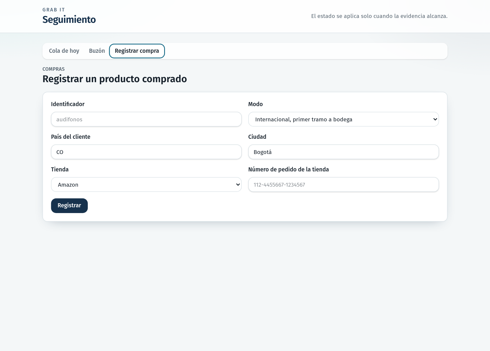
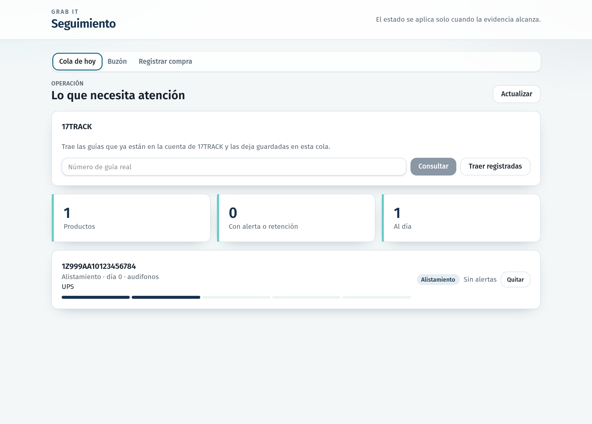
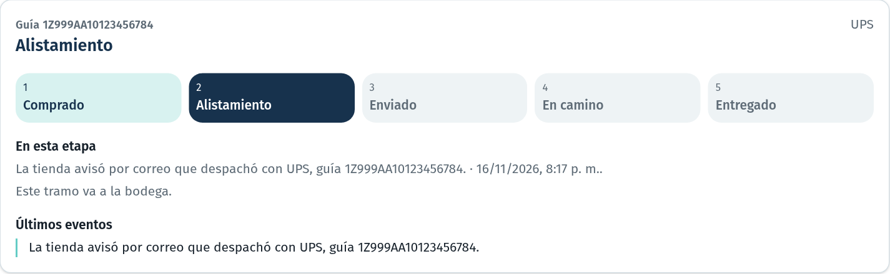
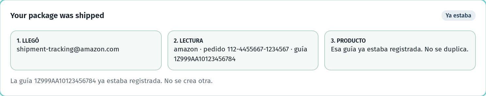

# Manual de usuario

GRAB IT · Seguimiento de envíos · Compras y operación · 18 de noviembre de 2026

[Centro de documentación](README.md) · [Video de demostración (5:03)](https://www.youtube.com/watch?v=Q6-VDQ_lRcY) · [Guía para TI](documentacion-tecnica.md)

## 1. Para qué sirve y qué necesita

Este manual está dirigido a quienes compran productos y revisan sus entregas. No necesita saber programar. TI debe haber instalado la consola y darle su dirección. Use un computador con navegador y acceso a la red donde está el sistema.

Usted registra la compra. El sistema puede leer la guía del correo de despacho, reunir las novedades de transporte y decidir si actualiza el estado. Si algo no coincide, conserva el estado anterior y muestra una retención para que una persona revise.

La solución está terminada y funcionando dentro del alcance aceptado en la reunión con el cliente. La integración real con 17TRACK y las APIs disponibles está conectada. También puede usar ejemplos para practicar sin modificar la operación real. Las capturas de este manual usan datos sintéticos; los números mostrados son ejemplos. La consola es la interfaz entregada para Compras y no reemplaza el portal del cliente ni Control.

## 2. Entrar a la consola

1. Abra Chrome, Edge o Firefox.
2. Escriba la dirección que le dio TI. Si está en el mismo equipo donde corre el sistema: http://127.0.0.1:8787.
3. Confirme que aparecen Cola de hoy, Buzón y Registrar compra.

La consola de prueba no pide una cuenta de usuario. Solo debe abrirse en el equipo o la red controlada que TI haya preparado. Si no abre, comunique a TI la dirección y el mensaje que aparece. Si dice que falta compilar la consola, la solución corresponde a TI.

## 3. Registrar una compra

Registre el producto antes de que llegue el correo de despacho. Si no está registrado, el sistema no sabrá a qué compra corresponde la guía.

1. Abra Registrar compra.
2. Complete los campos de la tabla.
3. Pulse Registrar.
4. Abra Cola de hoy y compruebe que el producto aparece en Comprado.

| Campo | Qué escribir |
| --- | --- |
| Identificador | Un nombre corto y único, por ejemplo audifonos-demo |
| Modo | Internacional si pasa por una bodega fuera de Colombia; Nacional si va directo al cliente |
| País y ciudad del cliente | El destino real de entrega; por ejemplo CO y Bogotá |
| Tienda | La tienda que aparece en el correo |
| Número de pedido | El número completo que entregó la tienda, sin confundirlo con la guía |

Ejemplo del recorrido de Amazon: identificador audifonos; modo Internacional; país CO; ciudad Bogotá; tienda Amazon; pedido 112-4455667-1234567. Use estos datos solo en la demostración. Para un pedido real, copie los datos de su compra.

## 4. Revisar Cola de hoy

Cada tarjeta corresponde a un producto. Muestra etapa, guía, transportadora y alertas. Arriba se resumen productos, productos que necesitan atención y productos al día. Pulse Actualizar para traer la información más reciente de la consola.

El recorrido visible al cliente se resume en Comprado → Alistamiento → Enviado → En camino → Entregado. En la consola puede ver nombres más precisos, como Pre-alertado o En bodega. Una entrega en una bodega internacional no significa que el cliente haya recibido el producto.

Haga clic en la guía para abrir la ficha. Allí se conservan los tramos, los eventos recibidos y el motivo de una retención. Compare la ciudad y el país del evento con el destino de la compra.

No utilice Quitar con pedidos reales: elimina el producto y parte de su historial, sin papelera. Resérvelo para ejemplos descartables. Si registró mal un pedido real, comuníquelo a TI o al responsable antes de modificarlo. Corregir una guía mediante anulación conserva su registro; es distinto de quitar un producto.

## 5. Atender alertas y retenciones

Empiece por las tarjetas retenidas o con alerta. Abra la ficha, lea el motivo y confirme con la tienda, la transportadora o el responsable correspondiente. No anuncie Entregado por una sola señal dudosa.

| Mensaje | Qué significa | Qué hacer |
| --- | --- | --- |
| Retenido | El sistema recibió una novedad, pero no tiene pruebas suficientes para cambiar el estado | Lea el motivo y confirme los datos antes de avisar al cliente |
| Revisión | Hay datos que no coinciden, como fechas anteriores al registro | Compare la guía y el pedido con el correo original |
| Destino | La ciudad o país no coincide | Confirme la dirección con la transportadora y el cliente |
| Sin guía | La transportadora no reconoce el número | Compare el número con el aviso de despacho |
| Sin novedad | Se agotó el plazo sin movimiento | Pregunte a la tienda o transportadora y registre la gestión |
| Falta guía | Terminó un tramo y falta el siguiente | Pida la guía a la bodega o courier |
| Entrega parcial | Falta una o más cajas | Espere o confirme las cajas faltantes |
| Preguntar | Llegó la fecha de consultar el pedido | Contacte al responsable del envío |

Ejemplo: el cliente está en Bogotá, pero el evento dice Entregado en Medellín. La decisión queda retenida. Verifique la dirección; no trate esa entrega como confirmación del cliente. Si después llega evidencia válida en Bogotá, el sistema vuelve a evaluar el estado.

## 6. Revisar correos en Buzón

TI configura la cuenta y prueba la conexión. Para su trabajo cotidiano:

1. Abra Buzón y compruebe que la vigilancia esté activa.
2. Para una lectura inmediata, pulse Leer ahora.
3. Revise la extracción terminada. Cada mensaje muestra Llegó, Lectura y Producto.
4. Compruebe que la tienda, el pedido y la guía corresponden a la compra correcta.

La vigilancia revisa el correo aproximadamente cada 45 segundos mientras el servidor esté encendido. Cada lectura tiene un límite de mensajes; si hay muchos correos atrasados, pida a TI que revise el periodo y la recuperación. Actualizar la página no obliga a una transportadora a producir una nueva novedad.

Si aparece Ningún producto tiene ese pedido o sin producto, confirme primero que esa compra pertenece a la operación. Si es correcta:

1. Revise la tienda y el número de pedido leídos.
2. Escriba la ciudad real del cliente.
3. Elija Nacional o Internacional.
4. Pulse Vincular y compruebe el producto en Cola de hoy.

| Resultado | Cómo actuar |
| --- | --- |
| Ya estaba | La guía ya existía; no debe volver a registrarla |
| Ignorado | Puede ser publicidad o un correo sin datos de despacho; revise si esperaba una guía |
| Sin guía | Espere el aviso que sí contenga la guía o pídala a la tienda |
| Formato desconocido | Avise a TI con un ejemplo del correo, ocultando datos personales innecesarios |
| Error de conexión | Avise a TI; no publique ni comparta contraseñas en capturas |

## 7. Seguimiento y modo de demostración

El bloque de 17TRACK permite Consultar una guía y Traer registradas. TI debe indicar si la instalación usa ejemplos grabados o consulta real. Sin una llave de API, el modo predeterminado usa respuestas de prueba; una tarjeta de ejemplo no confirma un envío real.

En modo real, Consultar puede registrar una guía y consumir la cuota del servicio. Si la guía no existía en el módulo, puede crearse un producto auxiliar con valores de demostración; compruebe el destino, la tienda y la compra con TI antes de usarlo para informar al cliente. Traer registradas importa guías de la cuenta; no sustituye la conciliación de pedidos.

Cargar correos de ejemplo y las demostraciones deben usarse únicamente con la base de prueba indicada por TI. No ejecute las demostraciones sobre pedidos reales. Los botones de envío de aviso utilizan la cuenta configurada; coordine su uso para no confundir esos correos con despachos de la operación.

### Cómo ayuda la inteligencia artificial

Cuando TI habilita esta función, el sistema puede interpretar frases de un correo o de una novedad de transporte que las reglas no reconocen con claridad. Por ejemplo, una frase que describe que el cliente recibió el paquete puede ayudar a identificar una entrega.

Usted no necesita escribir instrucciones a la IA ni configurar una cuenta adicional. Revise siempre el estado y las razones de la ficha. Un correo que solo anuncia el despacho sigue siendo un despacho, y una entrega en otra ciudad necesita revisión. Si el servicio de IA no responde, el sistema conserva su lectura habitual por reglas.

## 8. Ejercicio práctico sin correo real

Pida a TI una instalación descartable en modo de ejemplos. Este ejercicio no necesita credenciales.

1. Registre el ejemplo de Amazon de la sección 3.
2. Abra Buzón y pulse Cargar correos de ejemplo.
3. Busque el mensaje Amazon del pedido 112-4455667-1234567.
4. Compruebe que aparece asociado a audifonos con la guía 1Z999AA10123456784.
5. Abra Cola de hoy y la ficha. El correo de despacho puede dejar la etapa Enviado; no equivale a una entrega al cliente.
6. Vuelva a cargar los ejemplos y confirme Ya estaba para esa guía.

Resultado esperado: una compra asociada a su guía y sin duplicado al repetir la lectura. Otros correos del ejercicio pueden quedar sin producto o sin guía; eso permite practicar la revisión de excepciones.

## 9. Dudas frecuentes y ayuda

¿Tengo que consultar todas las transportadoras? Con las integraciones reales configuradas, revise principalmente las alertas. En una instalación de prueba los ejemplos no sustituyen la consulta real.

¿Por qué una guía puede cambiar? Un producto puede pasar por bodega, courier y última milla. Las guías pertenecen a tramos distintos y se deben conservar en la misma ficha.

¿Por qué no cambia el estado? Puede faltar evidencia, la entrega ser parcial, no coincidir el destino o no haber llegado una novedad real. Abra la ficha antes de pedir un cambio manual.

¿Se actualiza después de apagar el equipo? TI debe encender el servidor. Cuando una cuenta de buzón válida está guardada, la versión de esta entrega vuelve a activar su vigilancia al arrancar. Compruebe su estado en Buzón.

¿Qué hago si registré mal una compra? Anote el identificador y el dato incorrecto y avise al responsable. No quite un pedido real para corregirlo sin un procedimiento de conservación.

¿Qué envío a soporte? La acción que estaba intentando, la hora aproximada, el identificador del producto, el mensaje de error y una captura sin contraseñas ni datos personales innecesarios. Utilice el canal de soporte acordado para la operación.

Antes de terminar su revisión diaria: atienda las tarjetas retenidas, compruebe que el buzón esté funcionando y deje registradas las gestiones pendientes. Las capturas de ejemplo explican el uso del sistema. Los beneficios económicos se revisan durante la operación sin modificar la aceptación funcional ya acordada con el cliente.

Fuente: consola, código y capturas del repositorio [prototype-grabit](https://github.com/EstebanForero/prototype-grabit), base funcional [`071fb83`](https://github.com/EstebanForero/prototype-grabit/tree/071fb8357351e7d38d23e29d142617cfe1c2d6f0). Las capturas son ejemplos de uso con datos sintéticos.
