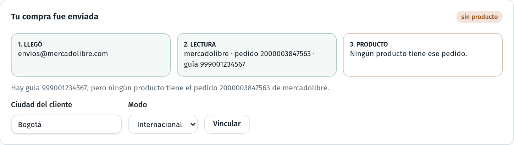

# Manual de usuario: seguimiento de envíos

Este manual es para el equipo de Compras y de operación de Grab It. No hace falta saber programar. Si el sistema no abre o hay que instalarlo, eso lo hace TI con la [documentación técnica](documentacion-tecnica.md).

Las imágenes son de la consola corriendo con los correos de ejemplo que trae el proyecto. Los números de pedido y de guía son de prueba.

## 1. Qué hace el sistema

Antes, para saber dónde iba un paquete había que abrir la página de cada transportadora, buscar la guía, copiar el estado y responderle al cliente. El sistema hace esa parte solo:

1. Usted registra la compra con la tienda y el número de pedido.
2. Cuando la tienda manda el correo de despacho, el sistema lo lee, saca la guía y la pega al producto.
3. Las novedades de la transportadora llegan por 17TRACK, un servicio que reúne el seguimiento de miles de transportadoras.
4. Con esa información el sistema decide si mueve el estado del producto o si lo **retiene**.

La regla es simple: **el estado se aplica solo cuando la evidencia alcanza**. Si algo no cuadra, por ejemplo la transportadora dice "entregado" pero en otra ciudad, el estado no se mueve y el producto queda para que una persona lo revise. Su trabajo pasa a ser atender esas excepciones, no consultar todo a mano.

## 2. Cómo entrar a la consola

1. Abra el navegador (Chrome, Edge o Firefox) en el computador de la oficina.
2. Escriba la dirección que le dio TI. En una instalación local es `http://127.0.0.1:8787`.
3. La consola no pide usuario. Está pensada para la red interna de Grab It.

Arriba hay tres pestañas: **Cola de hoy**, **Buzón** y **Registrar compra**.

Si la página dice que la consola no está compilada o no carga, avísele a TI. No es algo que usted tenga que arreglar.

## 3. Registrar una compra

Haga esto apenas se compre el producto, antes de que llegue la guía. Si el producto no está registrado, el correo de la tienda no tiene a qué pegarse.

| Campo | Qué poner |
| --- | --- |
| Identificador | Un nombre corto para reconocer el producto, por ejemplo `audifonos`. |
| Modo | **Internacional** si va primero a la bodega en Estados Unidos. **Nacional** si va directo al cliente. |
| País y ciudad del cliente | A dónde tiene que llegar. El sistema compara esta ciudad con la de la entrega. |
| Tienda | Amazon, Mercado Libre, eBay, Alibaba o Homecenter. |
| Número de pedido | El número que da la tienda, tal cual aparece en su correo. |

Pulse **Registrar**. El producto aparece en **Cola de hoy** en la etapa **Comprado**.

## 4. Leer el estado de los envíos (Cola de hoy)

Arriba hay tres cifras: cuántos productos hay, cuántos tienen alguna alerta o retención y cuántos están al día.

Cada tarjeta es un producto. Muestra la guía, la transportadora, la etapa y una barra con cinco tramos:

**Comprado → Alistamiento → Enviado → En camino → Entregado**

Son los mismos cinco estados que ya ve el cliente. Al lado derecho de cada tarjeta aparece:

- la etapa actual, o la etiqueta **retenido** si el sistema no movió el estado;
- las alertas, si hay alguna (ver la tabla de abajo);
- **Sin alertas** cuando todo está en orden.

Para ver el detalle, haga clic en la guía de la tarjeta. Se abre la ficha:

La ficha dice en qué etapa está, de dónde salió esa información (el correo de la tienda o la transportadora) y los últimos eventos.

**Actualizar** vuelve a cargar la cola. **Quitar** borra el producto de la cola. Úselo solo si se registró por error.

## 5. Revisar lo retenido y las alertas

Esta es la parte del día que sí necesita a una persona. Revise primero las tarjetas que dicen **retenido** o que tienen una alerta.

| Lo que dice la tarjeta | Qué significa | Qué hacer |
| --- | --- | --- |
| **retenido** | La transportadora reportó algo, pero la evidencia no alcanzó para mover el estado. La razón aparece al lado. | Abra la ficha y lea la razón. Si es una entrega en otra ciudad o una entrega parcial, confirme con la transportadora o con el cliente antes de avisarle. |
| **Revisión** | Algo no cuadra, por ejemplo hay eventos anteriores al registro de la guía. Puede ser el paquete de otra persona. | Compare la guía con la del correo de la tienda. Si está mal, corríjala. |
| **Destino** | La ciudad o el país de la entrega no es la del cliente. | Confirme la dirección con el cliente y con la transportadora. |
| **Sin guía** | La transportadora no reconoce el número. A veces la guía se copió mal. | Revise el número en el correo de la tienda. |
| **Sin novedad** | Pasaron varios días sin movimiento. | Pregunte a la transportadora o a la tienda. |
| **Falta guía** | El tramo anterior terminó, pero no ha llegado la guía del siguiente. | Pida la guía del siguiente tramo a la bodega o al courier. |
| **Entrega parcial** | Llegó solo una parte de las cajas. | No avise "entregado" al cliente todavía. |
| **Preguntar** | Ya toca preguntar por el pedido. | Escríbale a la tienda o a la transportadora. |

El sistema nunca marca **Entregado** con una sola pista dudosa. Si usted ve un estado que le parece mal, no lo cambie por fuera: avísele a TI con la guía y lo que vio.

## 6. Cuando un correo no se reconoce (Buzón)

En la pestaña **Buzón** se ve cada correo que el sistema leyó, en tres pasos: **1. Llegó** (de quién), **2. Lectura** (qué tienda, pedido y guía encontró) y **3. Producto** (a qué producto quedó pegado).

Un correo que salió bien se ve así:

Si en el paso 3 dice **Ningún producto tiene ese pedido**, la tarjeta queda marcada **sin producto**:

Casi siempre es porque la compra no se registró antes. Desde la misma tarjeta:

1. Escriba la ciudad del cliente.
2. Elija el modo: **Internacional** o **Nacional**.
3. Pulse **Vincular**. El sistema crea el producto con ese pedido y le pega la guía.

Otros casos:

- **Ya estaba**: esa guía ya se había leído. No se crea nada nuevo y no hay que hacer nada.
- **Ignorado**: el correo no es un despacho (publicidad, por ejemplo). No hay que hacer nada.
- **El correo trae el pedido pero no la guía**, como pasa a veces con Alibaba: espere el siguiente correo de la tienda o pídale la guía.
- **Una tienda nueva o un correo con formato raro** que el sistema no entiende: avísele a TI y reenvíeles el correo. Ellos lo agregan a las pruebas para que la próxima vez sí se lea.

La cuenta de correo y la vigilancia del buzón las configura TI. Si ve **Vigilancia detenida** y no están llegando guías, avísele a TI.

## 7. Preguntas frecuentes

**¿Tengo que entrar a la página de la transportadora?**
Solo para los productos retenidos o con alerta. El resto se mueve solo.

**¿Cada cuánto se actualiza?**
El buzón se lee cada 45 segundos cuando la vigilancia está activa. Las novedades de 17TRACK llegan cuando la transportadora reporta algo. Pulse **Actualizar** para ver lo último.

**¿Qué ve el cliente?**
Los mismos cinco estados, sin guías, sin nombres de transportadora y sin las alertas internas.

**Registré mal un producto. ¿Qué hago?**
Pulse **Quitar** en la tarjeta y regístrelo otra vez con los datos correctos.

**Un producto tiene dos guías.**
Es normal: una de la bodega en Miami, otra del courier y otra de la última milla. El sistema las guarda en orden en la misma ficha.

**¿Para qué es el bloque 17TRACK de Cola de hoy?**
**Consultar** busca una guía real en 17TRACK. **Traer registradas** baja las guías que ya están en la cuenta. Cada guía nueva que se consulta gasta cuota de la cuenta, así que úselo solo cuando haga falta.

**La consola no abre o dice que hay un error.**
Avísele a TI. Dígale qué estaba haciendo y, si puede, mándele una captura de pantalla.
